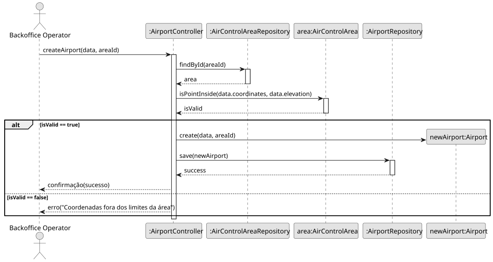

# Aggregate Justification: Air Control Area

The `Airport` aggregate's responsibility is to ensure that an airport can only be created if it belongs to a valid Air Control Area (ACA) and its geographical coordinates fall within that ACA's boundaries. This invariant is enforced through the collaboration between aggregates:

1. **Retrieval of Related Aggregate**: The `AirportController` first retrieves the `AirControlArea` aggregate using the provided `areaId`. This ensures the target ACA exists in the system.

2. **Invariant Validation**: The controller delegates the geographical validation to the `AirControlArea` aggregate by calling `isPointInside(coordinates, elevation)`. This method encapsulates the business logic of checking whether a point lies within the ACA's defined boundaries. This demonstrates that the `AirControlArea` is responsible for knowing its own boundaries, while the `Airport` relies on this validation.

3. **Conditional Creation**: Only if the validation returns `true` (the point is inside the ACA) does the controller proceed to create the `Airport` aggregate. If validation fails, the airport is never instantiated or persisted, preserving the invariant.

4. **Internal Consistency**: Once created, the `Airport` aggregate maintains its own internal invariants (e.g., unique IATA/ICAO codes, valid coordinates format) and stores a reference to its parent ACA via `areaId`.

This design ensures that the invariant *"An airport must be geographically located within the boundaries of exactly one Air Control Area"* is always enforced before any `Airport` aggregate is persisted, maintaining domain consistency and preventing invalid data from entering the system.

# Sequence Diagram 

