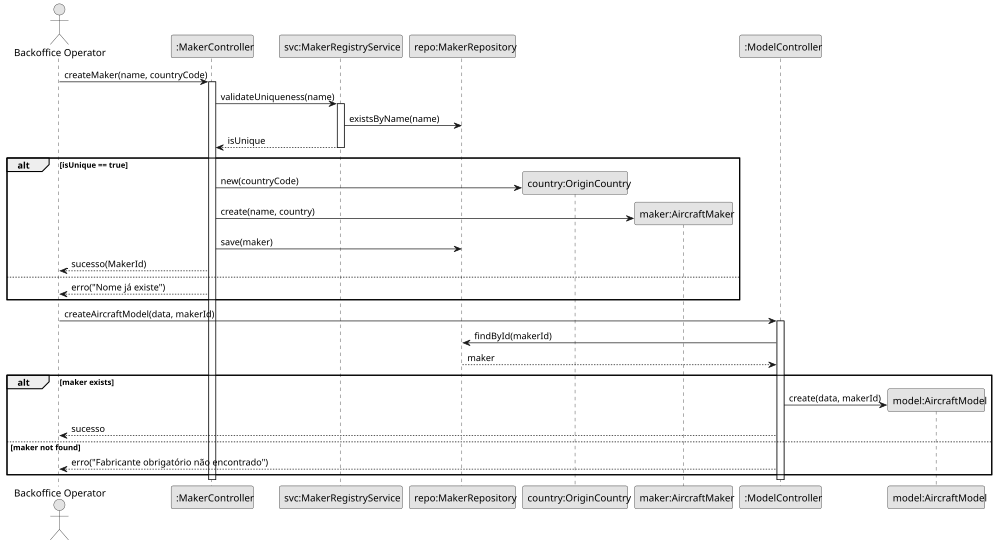

# Aggregate Justification: AircraftMaker

The `AircraftMaker` aggregate's responsibility is to ensure that each manufacturer has a unique name and a valid country of origin, serving as a mandatory prerequisite for creating any `AircraftModel` or `EngineModel`. This invariant is enforced through the collaboration between domain services, value objects, and the aggregate root:

1. **Uniqueness Validation via Domain Service**: Since an aggregate cannot validate its own uniqueness against the entire database, a `DomainService` consults the `MakerRepository` to check if a manufacturer with the given name already exists. This ensures that the invariant *"A manufacturer name must be unique in the system"* is enforced before creation.

2. **Value Object Validation**: The input data is validated through value objects before the aggregate is instantiated:
    - `OriginCountry` – A value object that validates the country code, ensuring the country of origin is valid at construction time.
    - `MakerType` – A value object that restricts the manufacturer type to a predefined set of values (e.g., Aircraft or Engine), preventing invalid types from being assigned.

3. **Conditional Creation**: Only if both validations succeed (name is unique and all value objects are valid) does the system proceed to create the `AircraftMaker` aggregate with a unique `MakerId`. If either validation fails, the operation is rejected with an appropriate error message, and no aggregate is created.

4. **Availability for Dependencies**: Once persisted, the `MakerId` becomes available for other aggregates (such as `AircraftModel` and `EngineModel`) to reference. This enforces the domain rule that no aircraft or engine model can be created without a valid, pre-existing manufacturer.

5. **Internal Consistency**: The `AircraftMaker` aggregate maintains its own internal state, including the name, type, and country of origin, ensuring that these values remain consistent throughout the aggregate's lifecycle.

This design ensures that the invariant *"A manufacturer must have a unique name and a valid country of origin, serving as a mandatory prerequisite for aircraft and engine models"* is always enforced at creation time. By using a domain service for uniqueness validation and value objects for attribute validation, the system maintains domain integrity and prevents inconsistent or duplicate manufacturers from entering the system.

# Sequence Diagram: 

