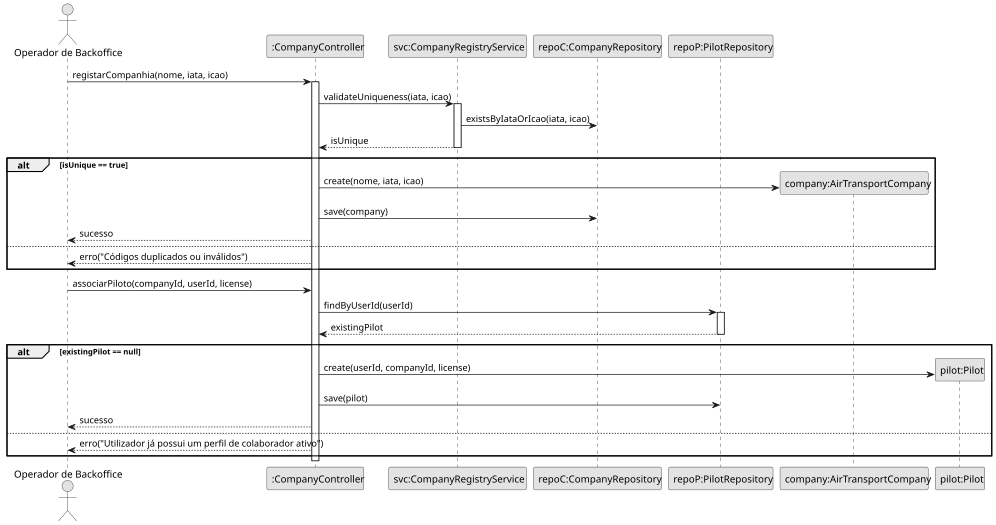

# Aggregate Justification: AirTransportCompany

The `AirTransportCompany` aggregate's responsibility is to ensure that the company has unique and correctly formatted IATA/ICAO identification codes, and that each collaborator (e.g., pilot) is uniquely associated with a single system user profile. This invariant is enforced through the collaboration between the aggregate root, domain services, and identity-based references:

**Part 1 – Company Registration Invariant**

1. **Internal Format Validation**: The `AirTransportCompany` aggregate root validates that the IATA code follows the required format (2 letters) and the ICAO code follows the required format (2-3 letters) at creation time. This ensures that only properly formatted codes enter the system.

2. **Uniqueness Validation via Domain Service**: Since the aggregate cannot query the entire database by itself, a `CompanyRegistryService` (domain service) consults the `CompanyRepository` to verify that no existing company uses the same IATA or ICAO code. This enforces the invariant *"IATA and ICAO codes must be unique across all companies"*.

3. **Conditional Creation**: Only if both format and uniqueness validations succeed does the system create and persist the `AirTransportCompany` aggregate with a unique `CompanyId`.

**Part 2 – Collaborator Management Invariant**

4. **Exclusivity Validation**: When adding a collaborator (e.g., a pilot), the system verifies that the given `UserId` is not already associated with an active collaborator profile (pilot or other role) for the same company. This is done by consulting the `PilotRepository` to check for existing associations.

5. **Identity-Based Reference Creation**: A new aggregate (e.g., `Pilot`) is created, storing only the `UserId` and `CompanyId` as references. This follows the principle of referencing other aggregates by identity rather than by direct object reference, maintaining aggregate isolation and scalability.

6. **Conditional Association**: If the user already has an active collaborator profile, the operation is rejected with an error message. Only if the user is not already associated does the system create and persist the new collaborator aggregate.

This design ensures the invariant *"An air transport company must have unique and correctly formatted IATA/ICAO codes, and each collaborator must be uniquely associated with a system user profile"* is always enforced. By using a domain service for cross-aggregate uniqueness validation, value objects for code format validation, and identity-based references for relationships, the system maintains domain integrity while preserving aggregate boundaries and scalability.
# Sequence Diagram
