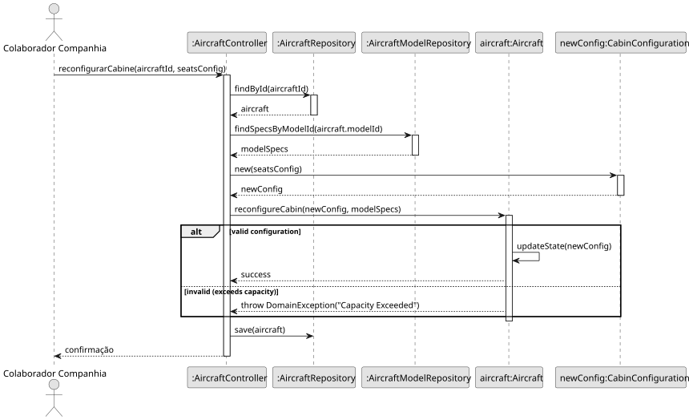

# Aggregate Justification: Aircraft

The `Aircraft` aggregate's responsibility is to ensure that its cabin configuration (number of seats per class) never exceeds the maximum capacity defined by its `AircraftModel`. This invariant is enforced through the collaboration between aggregates:

1. **Retrieval of Related Aggregates**: The `AircraftController` first retrieves the `Aircraft` aggregate using the provided `aircraftId`. It then retrieves the `AircraftModel` specifications by calling `findSpecsByModelId(aircraft.modelId)`. This ensures the system has both the current aircraft state and the model's capacity limits.

2. **Creation of Value Object**: The controller creates a new `CabinConfiguration` value object with the seat configuration provided by the user. This value object encapsulates the seat distribution across different classes.

3. **Invariant Validation**: The controller delegates the validation to the `Aircraft` aggregate by calling `reconfigureCabin(newConfig, modelSpecs)`. This method calculates the total number of seats from the `CabinConfiguration` and compares it against the `maxCapacity` from the `AircraftModel`. This demonstrates that the `Aircraft` aggregate is responsible for protecting its own consistency, using external reference data (the model specs) to validate the operation.

4. **Conditional Update**: Only if the total seats are less than or equal to the model's capacity does the `Aircraft` update its internal state with the new cabin configuration. If the validation fails, a `DomainException` is thrown, and the aircraft state remains unchanged.

5. **Persistence**: After a successful reconfiguration, the updated `Aircraft` aggregate is persisted via the repository.

This design ensures that the invariant *"The total number of seats in the cabin configuration cannot exceed the aircraft model's maximum capacity"* is always enforced before any state change is committed. The `Aircraft` aggregate acts as the guardian of its own consistency, preventing invalid configurations from corrupting the domain.

# Sequence Diagram

