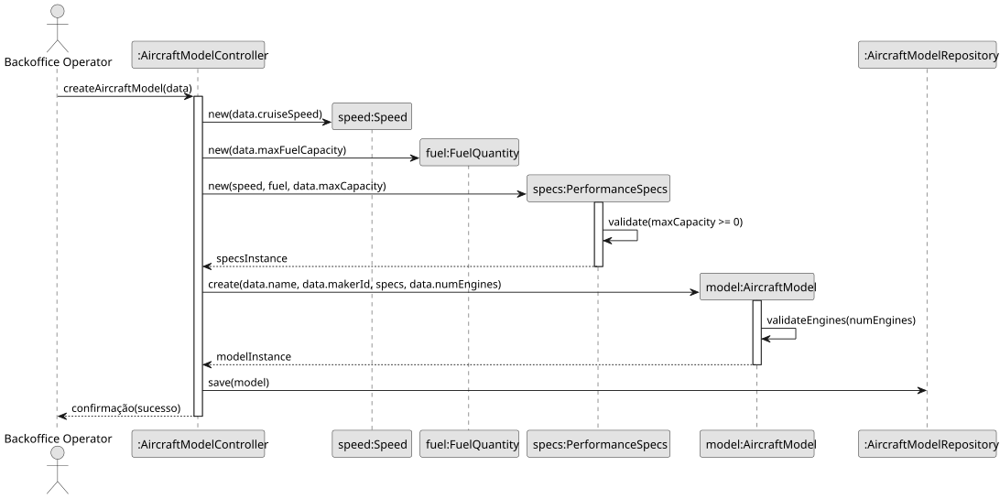

# Aggregate Justification: AircraftModel

The `AircraftModel` aggregate's responsibility is to ensure that all performance specifications (such as cruise speed, maximum fuel capacity, and passenger capacity) are strictly positive and coherent with the aircraft type. This invariant is enforced through the collaboration between value objects and the aggregate root:

1. **Value Object Validation**: Before any aggregate is created, each physical quantity is instantiated as a value object that validates its own invariants:
    - `Speed` – Validates that cruise speed is strictly positive.
    - `FuelQuantity` – Validates that maximum fuel capacity is strictly positive.
    - `Altitude` – Validates that service ceiling is strictly positive.
    - `Weight` – Validates that empty weight, MTOW, and MZFW are strictly positive.

   If any value is negative or zero (where not permitted), the value object is not created, preventing an invalid state from propagating.

2. **Performance Specifications Value Object**: The `PerformanceSpecs` value object aggregates all individual performance value objects and validates cross-field invariants, such as ensuring `maxCapacity` (maximum passenger capacity) is non-negative and coherent with other specifications.

3. **Aggregate Root Validation**: The `AircraftModel` aggregate root performs structural validations to ensure domain coherence:
    - Validates that the model has at least one certified engine associated.
    - Ensures that the engine type is compatible with the aircraft type (e.g., jet aircraft must have jet engine specifications).
    - Validates that the number of engines is strictly positive.

4. **Uniqueness Validation via Domain Service**: A domain service consults the `AircraftModelRepository` to verify that the combination of model name and manufacturer is unique, ensuring the invariant *"The combination of model name and manufacturer must be unique"* is enforced.

5. **Conditional Creation**: Only if all validations succeed (all value objects are valid, cross-field invariants hold, and uniqueness is confirmed) does the system proceed to create and persist the `AircraftModel` aggregate. If any validation fails, the operation is rejected with an appropriate error message.

This design ensures that the invariant *"All performance specifications must be strictly positive and coherent with the aircraft type"* is always enforced at creation time. By using value objects to encapsulate and validate individual physical quantities, and having the aggregate root enforce structural invariants, the system maintains domain integrity and prevents inconsistent aircraft models from entering the system, ensuring that airlines can only add aircraft to their fleets based on valid, well-defined models.

# Sequence Diagram
