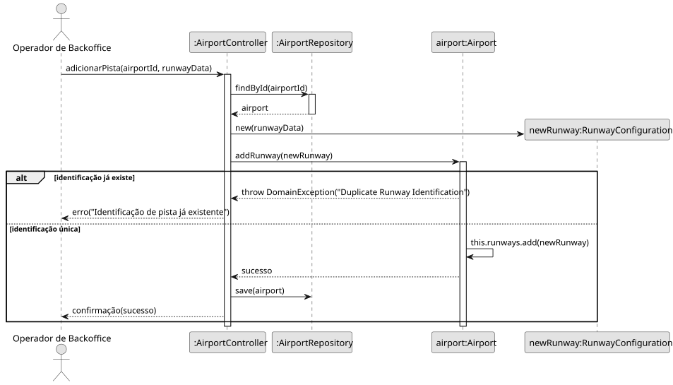

## Aggregate Justification: Airport

The `Airport` aggregate's responsibility is to ensure that no two runways within the same airport share the same identification. This invariant is enforced by the aggregate root, which manages its internal collection of runways:

1. **Retrieval of the Aggregate**: The `AirportController` first retrieves the `Airport` aggregate from the `AirportRepository` using the provided `airportId`. This ensures the target airport exists in the system.

2. **Creation of Value Object**: The new runway is instantiated as an immutable value object (`RunwayConfiguration`). This value object validates its own internal invariants at construction time, such as ensuring dimensions are positive and orientation is within valid ranges.

3. **Invariant Validation by the Aggregate Root**: The `Airport` aggregate root receives the command to add the new runway and validates the invariant internally. It iterates through its existing collection of runways to check if a runway with the same identification already exists. This demonstrates that the aggregate root is responsible for protecting the consistency of its own internal state.

4. **Conditional Update**:
    - If a runway with the same identification already exists, the operation is rejected with an error message, and the aggregate state remains unchanged.
    - If the identification is unique, the aggregate root adds the new `RunwayConfiguration` to its internal collection.

5. **Persistence**: After successful validation and state update, the modified `Airport` aggregate is persisted via the repository.

This design ensures that the invariant *"Within the same Airport aggregate, no two runways can have the same identification"* is always enforced before any state change is committed. By having the aggregate root manage its own collection and validate all modifications, the system maintains domain integrity and prevents operational confusion during flight simulations. The use of an immutable value object for `RunwayConfiguration` further guarantees that once created, a runway's properties cannot be altered inconsistently.

# Sequence Diagram
