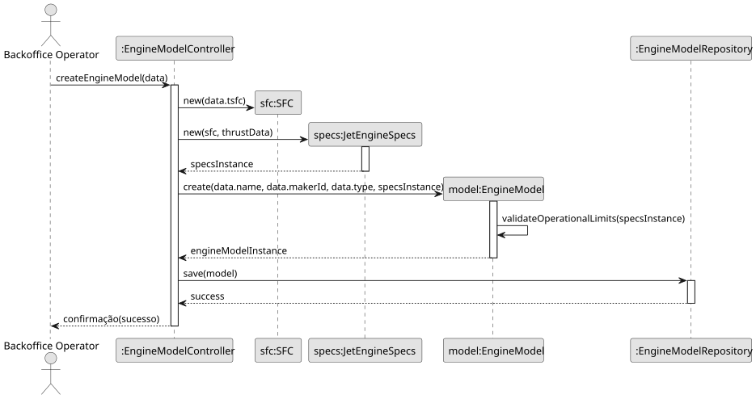

# Aggregate Justification: EngineModel

The `EngineModel` aggregate's responsibility is to ensure that all technical specifications, particularly Thrust Specific Fuel Consumption (TSFC), are strictly positive and within operational limits for the engine type. This invariant is enforced through the collaboration between value objects and the aggregate root:

**Part 1 – Value Object Validation**

1. **SFC Value Object**: The system instantiates `SFC` (Specific Fuel Consumption) as a value object that validates its own invariants at construction time. This ensures that TSFC values are strictly positive, enforcing the rule *"An engine cannot have negative or zero fuel consumption"*.

2. **JetEngineSpecs Value Object**: For jet engines, the `JetEngineSpecs` value object aggregates thrust data (sea level static thrust and cruise speed thrust) and the SFC value. It validates cross-field invariants, such as ensuring cruise thrust does not exceed sea level static thrust (a physical constraint).

3. **Type-Specific Specifications**: Depending on the engine type, different specification value objects are used:
    - `JetEngineSpecs` – For turbojet and turbofan engines
    - `ElectricEngineSpecs` – For electric engines (with different efficiency parameters)

**Part 2 – Aggregate Root Validation**

4. **Type-Specification Compatibility**: The `EngineModel` aggregate root verifies that the provided specifications are compatible with the engine type. Jet engines must have `JetEngineSpecs`, while electric engines must have `ElectricEngineSpecs`. This prevents invalid combinations, such as assigning jet thrust parameters to an electric motor.

5. **Operational Limits Validation**: The aggregate root validates that all operational parameters are within defined limits (e.g., maximum thrust, minimum fuel efficiency) appropriate for the engine type and intended use.

6. **Uniqueness Validation via Domain Service**: A domain service consults the `EngineModelRepository` to ensure that the combination of model name and manufacturer is unique, preventing duplicate engine models from being registered.

7. **Conditional Creation**: Only if all validations succeed (all value objects are valid, type-specification compatibility holds, and uniqueness is confirmed) does the system create and persist the `EngineModel` aggregate. If any validation fails, the operation is rejected with an appropriate error message.

This design ensures the invariant *"The Specific Fuel Consumption (SFC) of an engine must be a positive value and within operational limits for its type"* is always enforced at creation time. By using value objects to encapsulate and validate physical quantities, and having the aggregate root enforce type-specification compatibility and operational limits, the system maintains domain integrity, ensuring that only valid engine models can be associated with aircraft models for flight simulations.

# Sequence Diagram
