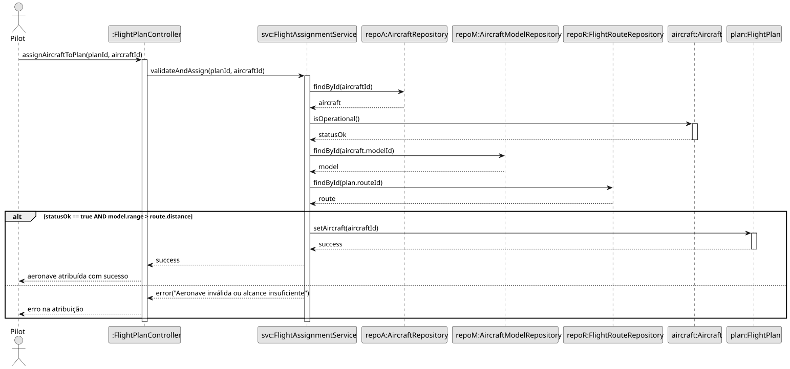

# Aggregate Justification: Flight

The `FlightPlan` aggregate's responsibility is to ensure that an aircraft can only be assigned to a flight if its maximum range (defined in its `AircraftModel`) is greater than the total route distance, and if the aircraft is in an operational (non-retired) state. This invariant is enforced through the collaboration of multiple aggregates coordinated by a domain or application service:

**Part 1 – Aircraft Operational Status Validation**

1. **Aircraft State Check**: The system retrieves the `Aircraft` aggregate using the provided `aircraftId` and verifies its operational status. The invariant *"An aircraft cannot be assigned to a flight if it has been decommissioned or retired"* is enforced by checking that the aircraft's status is not "Retired". If the aircraft is retired, the assignment is rejected immediately.

**Part 2 – Performance Validation (Cross-Aggregate Invariant)**

2. **Route Distance Retrieval**: The system obtains the total distance of the route associated with the flight plan by retrieving the `FlightRoute` aggregate. This provides the distance the aircraft must travel.

3. **Aircraft Range Retrieval**: The system obtains the maximum range from the `AircraftModel` referenced by the `Aircraft` aggregate. This value represents the maximum distance the aircraft can fly under normal conditions.

4. **Range Comparison Validation**: The critical safety invariant *"The aircraft's maximum range must be strictly greater than the route distance"* is enforced. If the range is less than or equal to the route distance, the aircraft cannot safely complete the flight, and the assignment is rejected.

**Part 3 – Identity-Based Association**

5. **Assignment by Identity**: Only if both validations succeed (aircraft is operational AND range > route distance) does the system proceed to associate the aircraft with the flight plan. The `FlightPlan` aggregate stores only the `AircraftId` as a reference, not the entire aircraft object.

6. **Reference by Identity Principle**: This identity-based reference ensures that the `FlightPlan` aggregate remains small and isolated from changes occurring in other aggregates (`Aircraft`, `AircraftModel`, `FlightRoute`). The flight plan only needs to know which aircraft is assigned, not all of its properties.

**Part 4 – Conditional Update**

7. **Success or Rejection**: If all validations pass, the flight plan is updated with the assigned aircraft, moving it closer to a ready state for safety simulation. If any validation fails, an appropriate error message is returned (e.g., "Aircraft is retired" or "Insufficient range for route"), and the flight plan remains unchanged.

This design ensures the invariants *"An aircraft cannot be assigned to a flight if its status is retired"* and *"The aircraft's maximum range must be greater than the total route distance for safe operation"* are always enforced before an aircraft is associated with a flight plan. By coordinating the validation across multiple aggregates (`Aircraft`, `AircraftModel`, `FlightRoute`) through a service, and using identity-based references, the system maintains domain integrity, ensures operational safety, and preserves aggregate boundaries and scalability.
# Sequence Diagram
