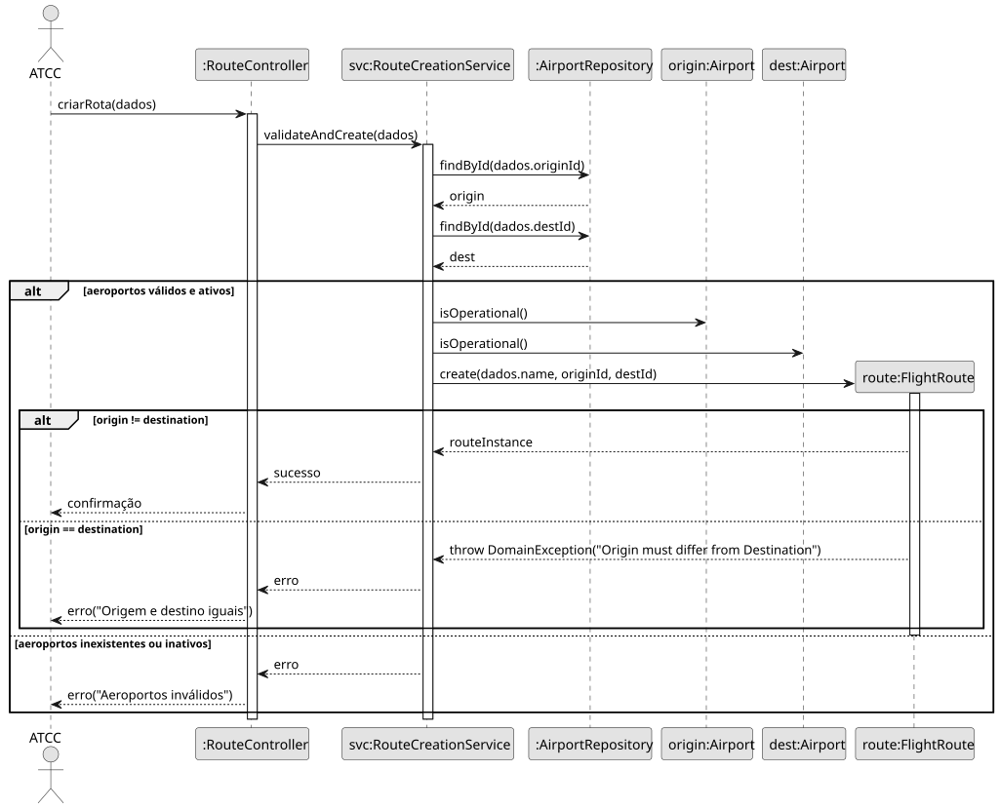

# Aggregate Justification: FlightRoute

The `FlightRoute` aggregate's responsibility is to ensure that a flight route is only valid if the origin airport is different from the destination airport and both airports are previously registered and operational in the system. This invariant is enforced through the collaboration between value objects, external aggregate references, and the aggregate root:

**Part 1 – Value Object Validation**

1. **FlightRouteName Value Object**: The system validates the route name through the `FlightRouteName` value object, which ensures that the name follows the required format: exactly 2 letters (the company's initials) followed by up to 4 digits (e.g., "TP123"). This value object validates its own internal invariants at construction time.

2. **Uniqueness Validation**: The uniqueness of the route name is verified globally to prevent duplicates in the system. This is typically done via a domain service consulting the `FlightRouteRepository`.

**Part 2 – External Dependencies Validation (Reference by Identity)**

3. **Airport Existence Check**: The system confirms the existence of both `Airport` aggregates by retrieving them from the `AirportRepository` using their respective IDs. This ensures that the referenced airports actually exist in the system.

4. **Airport Operational Status Check**: The system verifies that both airports have an operational status. The invariant *"Both airports must be registered and active (operational) in the system"* is enforced. If either airport is inactive, decommissioned, or non-existent, the route creation is rejected.

**Part 3 – Aggregate Root Invariant Validation**

5. **Origin-Destination Distinction**: The `FlightRoute` aggregate root (or a domain service coordinating the creation) validates the critical business rule: the origin airport must be different from the destination airport. If the origin and destination are the same, a `DomainException` is thrown with an appropriate message (e.g., "Origin must differ from destination").

6. **Distance and Duration Calculation**: Based on the coordinates of the referenced airports, the system calculates the estimated distance and duration of the route. These derived attributes are stored as part of the route's immutable characteristics.

**Part 4 – Conditional Creation**

7. **Successful Creation**: Only if all validations succeed (name format is valid, name is unique, both airports exist and are operational, and origin != destination) does the system create and persist the `FlightRoute` aggregate with a unique `FlightRouteId`.

8. **Rejection on Violation**: If any validation fails, the operation is rejected with an appropriate error message:
    - "Origin and destination cannot be the same"
    - "Invalid or inactive airports"
    - "Route name already exists" or "Invalid route name format"

This design ensures the invariants *"A flight route is only valid if the origin airport is different from the destination airport"* and *"Both airports must be previously registered and active in the system"* are always enforced at creation time. By using value objects for attribute validation, referencing other aggregates by identity, and having the aggregate root enforce the core business rule, the system maintains domain integrity and prevents logically impossible routes from being created, ensuring that future flight plans can rely on valid, consistent route definitions.

# Sequence Diagram
