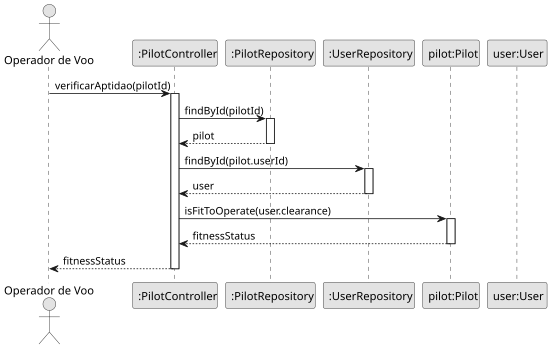

## Aggregate Justification: Pilot

The `Pilot` aggregate's responsibility is to ensure that a pilot's fitness to operate is only determined after validating their security clearance against the aggregate's own internal rules. This invariant is enforced through the collaboration between repositories and the Aggregate Root:

1. **Repository as Collection**: The `PilotController` resolves the `Pilot` aggregate via `PilotRepository.findById(pilotId)`, treating the repository as an in-memory collection. This keeps the controller free from persistence concerns and delegates lookup responsibility entirely to the repository.

2. **Reference by Identity**: The `Pilot` aggregate does not hold a direct reference to the `User` aggregate — it only knows the `userId`. The controller resolves this dependency at runtime via `UserRepository.findById(pilot.userId)`, following the DDD principle of cross-aggregate reference by identity and keeping both aggregates independently consistent.

3. **Invariant Enforcement at the Aggregate Boundary**: Rather than exposing the clearance check to the controller, the `Pilot` Aggregate Root receives the `user.clearance` value and performs the fitness evaluation internally via `isFitToOperate(user.clearance)`. This ensures that all business rules governing pilot aptitude — such as clearance expiry or periodic skills assessment — are encapsulated within the aggregate and cannot be bypassed by external actors.

4. **Single Responsibility for Fitness**: The `fitnessStatus` returned to the `Flight Control Operator` is always the product of the aggregate's own validation logic, guaranteeing that no caller can receive an approval that circumvents the aggregate's invariants.

This design ensures that the invariant *"A pilot may only be considered fit to operate if their associated user holds a valid and active security clearance, as evaluated exclusively by the Pilot aggregate"* is always enforced before any fitness result is presented, preventing unqualified pilots from being assigned to flights.

## Sequence Diagram

