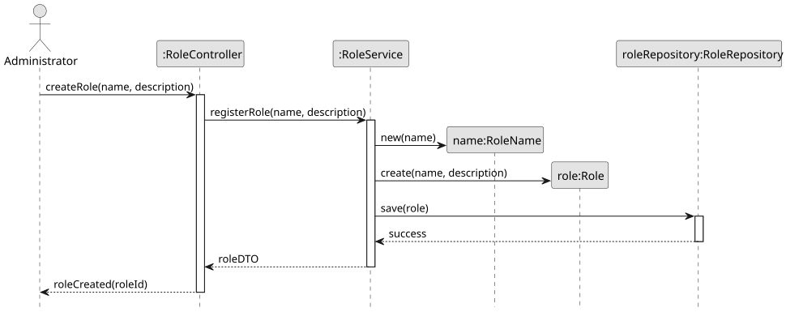

# Aggregate Justification: Role

The `Role` aggregate's responsibility is to ensure that a role is only admitted into the system when its identity invariant — a well-formed, non-null, non-empty name — is satisfied, and that the resulting entity is internally consistent before being persisted. This invariant is enforced through the collaboration between the `RoleService` application layer, the `RoleName` Value Object, and the Aggregate Root itself:

1. **Value Object construction before aggregate creation**: The `RoleService` does not pass raw strings to the `Role` aggregate. Instead, it first constructs the `RoleName` Value Object, which enforces its own attribute-level invariant (non-null, non-empty, format-compliant). If the constructor throws (e.g. empty or malformed name), the aggregate is never instantiated. This keeps validation concerns isolated and composable, and ensures that the `Role` Aggregate Root is only ever created from structurally sound building blocks.

2. **Aggregate boundary enforces the business invariant**: Once the `RoleName` Value Object is validated, `RoleService` calls `Role.create(name, description)`. At this moment, the Aggregate Root becomes the sole guardian of its own state consistency. No external actor can bypass or override this check; the aggregate either produces a valid `role` instance or throws a `DomainException`. The description, being optional/free-form, does not participate in the identity invariant, but the aggregate ensures that the role is built as an atomic, internally consistent unit.

3. **Persistence via the aggregate's repository**: After the aggregate is successfully created, `RoleService` delegates persistence to `RoleRepository.save(role)`. The repository — acting as an in-memory-style collection backed by a database — stores the Aggregate Root as a whole. The system never persists a half-formed or inconsistent role: if any step prior to `save` fails, no state ever reaches the persistence layer.

4. **Identity immutability**: Once created, the `RoleName` acts as the natural identifier of the aggregate and is treated as immutable for the full lifecycle of the object. The repository preserves this identity, preventing any external actor from manipulating it or the internal state of the aggregate directly. The `roleId` returned to the `Administrator` is a stable reference to the persisted aggregate.

5. **Clear separation of responsibilities**: The `RoleController` is responsible only for orchestrating the interaction with the `Administrator` and delegating to the application service. The `RoleService` coordinates the construction of Value Objects, the creation of the aggregate, and its persistence, but never enforces domain rules itself. The `Role` Aggregate Root and the `RoleName` Value Object are the only components that enforce invariants. This strict layering ensures that domain rules cannot be bypassed by the application layer or the caller.

This design ensures that the invariant *"a role may only exist in the system if it possesses a valid, non-empty, well-formed name and is created as an internally consistent aggregate"* is always enforced at the Aggregate Root boundary, before any persistence occurs, and is never delegable to the application layer or the caller.

## Sequence Diagram

