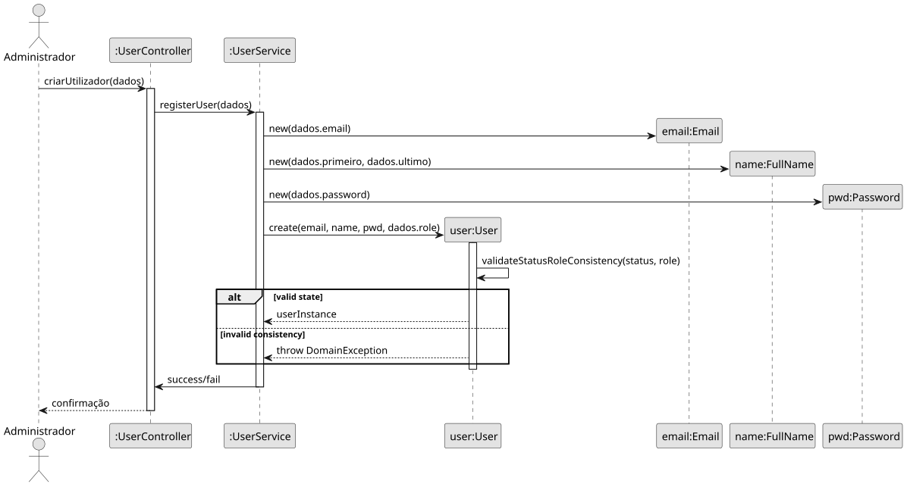

# Aggregate Justification: User

The `User` aggregate's responsibility is to ensure that a user is only admitted into the system when all three identity invariants are simultaneously satisfied — a well-formed email, a non-empty name, and a complexity-compliant password — and that the resulting entity is internally consistent in terms of status and role. This invariant is enforced through the collaboration between the `UserService` application layer, a set of Value Objects, and the Aggregate Root itself:

1. **Value Object construction before aggregate creation**: The `UserService` does not pass raw strings to the `User` aggregate. Instead, it constructs each Value Object independently — `Email`, `FullName`, and `Password` — each enforcing its own attribute-level invariant. If any of these constructors throws (e.g. malformed email, empty name, weak password), the aggregate is never instantiated. This keeps validation concerns isolated and composable, and ensures that the `User` Aggregate Root is only ever created from structurally sound building blocks.

2. **Aggregate boundary enforces the business invariant**: Once the three Value Objects are validated, `UserService` calls `User.create(email, name, pwd, role)`. At this moment, the Aggregate Root becomes the sole guardian of the cross-attribute constraint: `validateStatusRoleConsistency(status, role)`. This method verifies that the initial status — typically `Ativo` — is compatible with the permissions implied by the assigned role. No external actor can bypass or override this check; the aggregate either produces a valid `userInstance` or throws a `DomainException`.

3. **Conditional outcome and error propagation**: The `alt` fragment in the sequence diagram captures both branches. In the `[valid state]` branch, the aggregate returns a fully consistent `userInstance` to the `UserController`, which then reports success to the Administrator. In the `[invalid consistency]` branch, a `DomainException` propagates upward, and the Administrator receives a failure response. The system never persists a half-formed or inconsistent user.

4. **Identity immutability**: Once created, the `UserId` generated by the aggregate is treated as immutable for the full lifecycle of the object. The `UserRepository` — acting as an in-memory-style collection backed by a database — stores the Aggregate Root as a whole, preventing any external actor from manipulating its identity or internal state directly.

This design ensures that the invariant *"a user may only exist in the system if it simultaneously possesses a valid email, a non-empty name, a policy-compliant password, and a status that is consistent with its assigned role"* is always enforced at the Aggregate Root boundary, before any persistence occurs, and is never delegable to the application layer or the caller.

## Sequence Diagram

