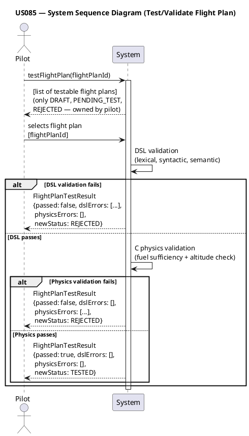

# US085 — Requirements Engineering

## 1. System Sequence Diagram (SSD)

The following SSD shows the interaction between the **Pilot** and the **System** for the full validation flow (DSL + physical test).

---

## 2. Domain Model Excerpt

The following class diagram shows only the classes relevant to US085, their key attributes, and relationships.

```plantuml
@startuml US085_DomainModel
title US085 — Domain Model Excerpt

skinparam classAttributeIconSize 0
hide empty members

' =================== FlightPlan Aggregate ===================
class FlightPlan <<(R,#FFCC66) Root>> {
    - id : FlightPlanId
    - designator : FlightPlanDesignator
    - status : FlightPlanStatus
    - flightType : FlightType
    - departureDateTime : DepartureDateTime
    - aircraft : RegistrationNumber
    - flightRoute : FlightRouteId
    - pilot : PilotId
    - legs : List<FlightLeg>
    - wind : FlightWind
    - dslSourcePath : String
    + markTestPassed() : void
    + markTestFailed() : void
}

class FlightPlanId <<(V,#9ACD32) Value Object>>
class FlightPlanDesignator <<(V,#9ACD32) Value Object>>
enum FlightPlanStatus {
    DRAFT
    SUBMITTED
    APPROVED
    REJECTED
    ACTIVE
    COMPLETED
    CANCELLED
    PENDING_TEST
    TESTED
}
enum FlightType {
    COMMERCIAL
    PRIVATE
    CARGO
}
class DepartureDateTime <<(V,#9ACD32) Value Object>>

class FlightLeg <<(E,#B0C4DE) Entity>> {
    - id : FlightLegId
    - departureAirport : AirportId
    - arrivalAirport : AirportId
    - legOrder : int
    - segments : List<FlightSegmentId>
    - fuelPlan : FuelPlan
    - weatherData : WeatherData
}
class FuelPlan <<(V,#9ACD32) Value Object>> {
    - totalFuel : double
    - reserveFuel : double
    - unit : MeasurementUnit
}
class FlightSegmentId <<(V,#9ACD32) Value Object>>

FlightPlan "1" *-- "1" FlightPlanId : identity
FlightPlan "1" *-- "1" FlightPlanDesignator : designator
FlightPlan "1" *-- "1" FlightPlanStatus : status
FlightPlan "1" *-- "1" FlightType : flightType
FlightPlan "1" *-- "1" DepartureDateTime : departure
FlightPlan "1" *-- "1..*" FlightLeg : legs
FlightLeg "1" *-- "1" FuelPlan : fuelPlan

' =================== Aircraft, Model, Engine ===================
class Aircraft <<(R,#FFCC66) Root>> {
    - registrationNumber : RegistrationNumber
    - aircraftModelId : AircraftModelId
    - ownerCompanyId : CompanyId
    - operationalStatus : AircraftOperationalStatus
}
class RegistrationNumber <<(V,#9ACD32) VO>>
class AircraftModel <<(R,#FFCC66) Root>> {
    - emptyWeightKg : double
    - mtowKg : double
    - mzfwKg : double
    - maxFuelCapacityLiters : double
    - serviceCeilingM : double
    - cruiseSpeedMs : double
    - wingAreaM2 : double
    - cd0 : double
    - cl : double
    - certifiedEngineModelIds : List<String>
}
class EngineModel <<(R,#FFCC66) Root>> {
    - id : EngineModelId
    - fuelSpecs : FuelSpecs
    - jetSpecs : JetEngineSpecs
}

Aircraft "1" --> "1" RegistrationNumber : identity
Aircraft "*" --> "1" AircraftModel : aircraftModelId
AircraftModel "1" --> "*" EngineModel : certifiedEngineModelIds

' =================== Airport & AirControlArea ===================
class Airport <<(R,#FFCC66) Root>> {
    - icaoCode : String
    - iataCode : String
    - name : String
    - latitude : double
    - longitude : double
    - elevationMeters : double
    - airControlArea : AirControlArea
}

class AirControlArea <<(R,#FFCC66) Root>> {
    - code : AirControlAreaCode
    - name : String
    - latMin, latMax, lonMin, lonMax : double
}

Airport "*" --> "1" AirControlArea : belongs to

' =================== Pilot ===================
class Pilot <<(R,#FFCC66) Root>> {
    - id : PilotId
    - name : FullName
    - email : Email
    - company : CompanyId
    - certification : PilotCertification
    - license : License
}

class PilotId <<(V,#9ACD32) VO>>

' =================== External ID References from FlightPlan ===================
class FlightRouteId <<(V,#9ACD32) VO>>
class PilotId2 <<(V,#9ACD32) VO>>
class AirportId <<(V,#9ACD32) VO>>

FlightPlan "*" --> "1" RegistrationNumber : aircraft (ref)
FlightPlan "*" --> "1" FlightRouteId : flightRoute (ref)
FlightPlan "*" --> "1" PilotId2 : pilot (ref)
FlightLeg "*" --> "2" AirportId : dep/arr (ref)

@enduml
```

---

## 3. Key Clarifications and Decisions

| # | Decision | Rationale |
|---|----------|-----------|
| 1 | **Two-stage pipeline (DSL then C)** | DSL validation is cheaper and catches formatting/logic errors early; the C physics test is only run after DSL passes. |
| 2 | **Testable statuses: DRAFT, PENDING_TEST, REJECTED** | `TESTED` and `COMPLETED` plans should not be re-tested. `PENDING_TEST` allows retry after weather data insertion (US082). `REJECTED` allows fixing and retrying. |
| 3 | **C executable invoked via ProcessBuilder** | The physics calculations are isolated in a separate C process for performance and to meet the "must be C" requirement. Communication is file-based (JSON). |
| 4 | **DSL re-validation on every test** | The DSL source file may have changed since the last import; re-validation ensures the test always runs against the current version. |
| 5 | **Ownership check before validation** | The controller verifies `pilotId.equals(flightPlan.getPilot())` before running any validation. The pilot is resolved from the authenticated session's email. |
| 6 | **Payload JSON is ephemeral** | The JSON file is written to a temp directory and deleted in a `finally` block after the C process completes. |
| 7 | **Segment altitudes read from DSL** | `DslSegmentProfileReader` re-parses the DSL file to extract altitude slot values, converting feet to meters where necessary. |
| 8 | **minFuelKg currently equals reserveFuelKg** | The AirControlArea `minimumFuelRequirement` field is not yet modelled; the current implementation uses the leg's reserve fuel as the minimum until US050 is fully integrated. |
