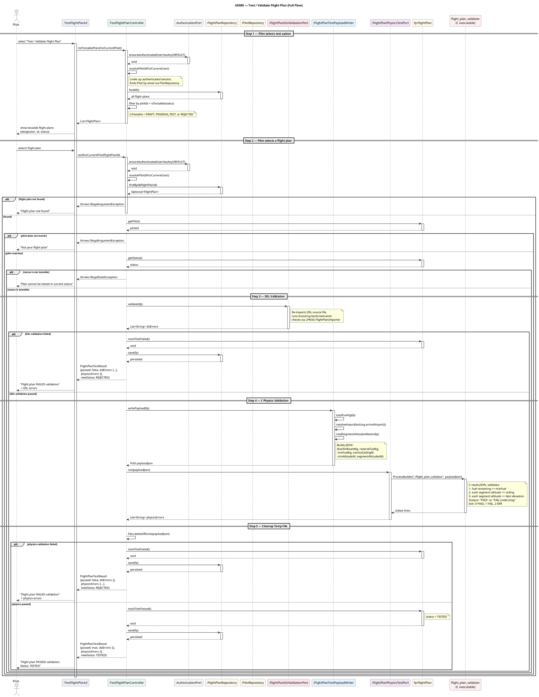

# US085 — Design

## A) Sequence Diagram (SD)

The full sequence diagram below shows the complete test/validate flow, including both DSL and C physics validation, as well as all error paths.



---

## B) Class Diagram (CD) — Design Level

The design-level class diagram shows all classes with full method signatures, associations, and multiplicities.

```plantuml
@startuml US085_Design_CD
title US085 — Design Class Diagram (Design Level)

skinparam classAttributeIconSize 0
hide empty members

' ====================================================================
' PRESENTATION LAYER
' ====================================================================
package "Presentation" #EEF0FB {
    class TestFlightPlanUI {
        - controller : TestFlightPlanController
        + doShow() : boolean
        + headline() : String
    }
}

' ====================================================================
' APPLICATION LAYER
' ====================================================================
package "Application" #E8F5F0 {

    class TestFlightPlanController {
        - authz : AuthorizationPort
        - flightPlanRepo : FlightPlanRepository
        - pilotRepo : PilotRepository
        - dslValidator : FlightPlanDslValidationPort
        - payloadWriter : FlightPlanTestPayloadWriter
        - physicsTester : FlightPlanPhysicsTestPort
        + {constructor} TestFlightPlanController()
        + {constructor} TestFlightPlanController(authz, flightPlanRepo, pilotRepo, dslValidator, payloadWriter, physicsTester)
        + listTestablePlansForCurrentPilot() : List<FlightPlan>
        + testForCurrentPilot(flightPlanId : FlightPlanId) : FlightPlanTestResult
        + test(flightPlanId : FlightPlanId, pilotId : PilotId) : FlightPlanTestResult
        + isTestable(status : FlightPlanStatus) : boolean {static}
        - resolvePilotIdForCurrentUser() : PilotId
    }

    interface FlightPlanDslValidationPort {
        + validate(flightPlan : FlightPlan) : List<String>
    }

    class FlightPlanDslFileValidator {
        - importer : FlightPlanImporter
        + {constructor} FlightPlanDslFileValidator()
        + validate(flightPlan : FlightPlan) : List<String>
        - resolveDslPath(flightPlan : FlightPlan) : Path {static}
    }

    interface FlightPlanTestPayloadWriter {
        + writePayload(flightPlan : FlightPlan) : Path
    }

    interface FlightPlanPhysicsTestPort {
        + run(inputJson : Path) : List<String>
    }

    class FlightPlanPhysicsValidator {
        - validatorBaseDir : Path
        + {constructor} FlightPlanPhysicsValidator(validatorBaseDir : Path)
        + run(inputJson : Path) : List<String>
    }

    class FlightPlanTestPayloadBuilder {
        - aircraftRepo : AircraftRepository
        - modelRepo : AircraftModelRepository
        - airportRepo : AirportRepository
        - profileReader : DslSegmentProfileReader
        + {constructor} FlightPlanTestPayloadBuilder(aircraftRepo, modelRepo, airportRepo)
        + writePayload(flightPlan : FlightPlan) : Path
        - totalFuelKg(plan : FlightPlan) : double
        - resolveAirport(airportId : AirportId) : Airport
    }

    class DslSegmentProfileReader {
        - importer : FlightPlanImporter
        + {constructor} DslSegmentProfileReader()
        + readSegmentAltitudesMeters(plan : FlightPlan) : List<Double>
        + toMeters(value : double, unit : String) : double {static}
        - resolveDslPath(plan : FlightPlan) : Path {static}
    }

    record FlightPlanTestResult {
        + passed : boolean
        + dslErrors : List<String>
        + physicsErrors : List<String>
        + newStatus : FlightPlanStatus
        + success() : FlightPlanTestResult {static}
        + failed(dslErrors : List<String>, physicsErrors : List<String>, status : FlightPlanStatus) : FlightPlanTestResult {static}
    }

    interface AuthorizationPort {
        + ensureAuthenticatedUserHasAnyOf(roles : Role[]) : void
        + currentUsername() : String
    }

    class FrameworkAuthorizationAdapter {
        + usingRegistry() : AuthorizationPort {static}
    }
}

' ====================================================================
' DOMAIN LAYER
' ====================================================================
package "Domain" #FFF8EC {

    class FlightPlan <<(R,#FFCC66) Root>> {
        - id : FlightPlanId
        - aircraft : RegistrationNumber
        - flightRoute : FlightRouteId
        - pilot : PilotId
        - designator : FlightPlanDesignator
        - status : FlightPlanStatus
        - flightType : FlightType
        - departureDateTime : DepartureDateTime
        - legs : List<FlightLeg>
        - wind : FlightWind
        - dslSourcePath : String
        + {constructor} FlightPlan(id, aircraft, flightRoute, designator, flightType, departureDateTime, legs, wind)
        + markTestPassed() : void
        + markTestFailed() : void
        + getStatus() : FlightPlanStatus
        + setStatus(status : FlightPlanStatus) : void
        + getPilot() : PilotId
        + setPilot(pilot : PilotId) : void
        + getAircraft() : RegistrationNumber
        + getDslSourcePath() : String
        + setDslSourcePath(path : String) : void
        + getDesignator() : FlightPlanDesignator
        + getLegs() : List<FlightLeg>
        + getId() : FlightPlanId
        + identity() : FlightPlanId
    }

    enum FlightPlanStatus {
        DRAFT
        SUBMITTED
        APPROVED
        REJECTED
        ACTIVE
        COMPLETED
        CANCELLED
        PENDING_TEST
        TESTED
    }

    class FlightLeg <<(E,#B0C4DE) Entity>> {
        - id : FlightLegId
        - departureAirport : AirportId
        - arrivalAirport : AirportId
        - legOrder : int
        - segments : List<FlightSegmentId>
        - fuelPlan : FuelPlan
        - weatherData : WeatherData
        + {constructor} FlightLeg(id, departureAirport, arrivalAirport, legOrder, segments, fuelPlan)
        + fuelPlan() : FuelPlan
        + arrivalAirport() : AirportId
        + departureAirport() : AirportId
        + identity() : FlightLegId
        + assignWeatherData(weatherData : WeatherData) : void
    }

    class FuelPlan <<(V,#9ACD32) Value Object>> {
        - totalFuel : double
        - reserveFuel : double
        - unit : MeasurementUnit
        + {constructor} FuelPlan(totalFuel, reserveFuel, unit)
        + totalFuel() : double
        + reserveFuel() : double
    }

    class FlightPlanDesignator <<(V,#9ACD32) Value Object>> {
        - value : String
        + {constructor} FlightPlanDesignator(value : String)
        + toString() : String
    }

    class FlightPlanId <<(V,#9ACD32) Value Object>> {
        + {static} newId() : FlightPlanId
    }

    class DepartureDateTime <<(V,#9ACD32) Value Object>> {
        - value : LocalDateTime
        + {constructor} DepartureDateTime(value : LocalDateTime)
    }

    class FlightType <<enum>> {
        COMMERCIAL
        PRIVATE
        CARGO
    }

    class RegistrationNumber <<(V,#9ACD32) VO>>
    class FlightRouteId <<(V,#9ACD32) VO>>
    class PilotId <<(V,#9ACD32) VO>>
    class AirportId <<(V,#9ACD32) VO>>
    class FlightLegId <<(V,#9ACD32) VO>>
    class FlightSegmentId <<(V,#9ACD32) VO>>

    ' -------------------- Other Aggregates (relevant excerpts) --------------------
    class Aircraft <<(R,#FFCC66) Root>> {
        - registrationNumber : RegistrationNumber
        - aircraftModelId : AircraftModelId
        - ownerCompanyId : CompanyId
        - operationalStatus : AircraftOperationalStatus
        + aircraftModelId() : AircraftModelId
    }

    class AircraftModel <<(R,#FFCC66) Root>> {
        - emptyWeightKg : double
        - mtowKg : double
        - mzfwKg : double
        - maxFuelCapacityLiters : double
        - serviceCeilingM : double
        - cruiseSpeedMs : double
        - wingAreaM2 : double
        - cd0 : double
        - cl : double
        + serviceCeilingM() : double
        + cruiseSpeedMs() : double
        + wingAreaM2() : double
        + cd0() : double
        + cl() : double
        + emptyWeightKg() : double
    }

    class Airport <<(R,#FFCC66) Root>> {
        - icaoCode : String
        - latitude : double
        - longitude : double
        - elevationMeters : double
        - airControlArea : AirControlArea
        + elevationMeters() : double
        + identity() : String
    }

    class Pilot <<(R,#FFCC66) Root>> {
        - id : PilotId
        - email : Email
        - company : CompanyId
        + identity() : PilotId
    }

    ' -------------------- Repository Interfaces --------------------
    interface FlightPlanRepository <<(I,#DDA0DD) Repository>> {
        + findById(id : FlightPlanId) : Optional<FlightPlan>
        + save(flightPlan : FlightPlan) : FlightPlan
        + ofIdentity(id : FlightPlanId) : Optional<FlightPlan>
        + findAll() : Iterable<FlightPlan>
        + findByDepartureYearMonth(year : int, month : int) : Iterable<FlightPlan>
        + hasAssignedFlightPlansFor(pilotId : PilotId) : boolean
    }

    interface AircraftRepository <<(I,#DDA0DD) Repository>> {
        + ofIdentity(id : RegistrationNumber) : Optional<Aircraft>
    }

    interface AircraftModelRepository <<(I,#DDA0DD) Repository>> {
        + ofIdentity(id : AircraftModelId) : Optional<AircraftModel>
    }

    interface AirportRepository <<(I,#DDA0DD) Repository>> {
        + findById(code : String) : Optional<Airport>
    }

    interface PilotRepository <<(I,#DDA0DD) Repository>> {
        + findByEmail(email : Email) : Optional<Pilot>
        + findActiveByCompanyId(companyId : CompanyId) : Iterable<Pilot>
        + ofIdentity(id : PilotId) : Optional<Pilot>
        + findAll() : Iterable<Pilot>
    }
}

' ====================================================================
' INFRASTRUCTURE LAYER
' ====================================================================
package "Infrastructure / Persistence" #EAF3FB {
    class JpaFlightPlanRepository <<Repository>>
    class JpaAircraftRepository <<Repository>>
    class JpaAircraftModelRepository <<Repository>>
    class JpaAirportRepository <<Repository>>
    class JpaPilotRepository <<Repository>>

    class PersistenceContext {
        + repositories() : RepositoryFactory {static}
    }

    interface RepositoryFactory <<AbstractFactory>> {
        + flightPlans() : FlightPlanRepository
        + pilots() : PilotRepository
        + aircraft() : AircraftRepository
        + aircraftModels() : AircraftModelRepository
        + airports() : AirportRepository
    }

    class JpaRepositoryFactory <<Factory>>
    class InMemoryRepositoryFactory <<Factory>>
    class FrameworkAuthorizationAdapter2 <<Factory>> {
        + usingRegistry() : AuthorizationPort {static}
    }
}

' ====================================================================
' C COMPONENT (External)
' ====================================================================
package "C Validator (lapr.base)" #FFF0F0 {
    class flight_plan_validator <<executable>> {
        main(argc, argv)
        run_flight_plan_test(json_path)
        validate_fuel_on_board(json)
        validate_segment_altitudes(json)
        read_payload_file(filename)
        extract_number(json, key)
    }
}

' ====================================================================
' RELATIONS — Presentation
' ====================================================================
TestFlightPlanUI ..> TestFlightPlanController : <<creates / uses>>

' ====================================================================
' RELATIONS — Application composition
' ====================================================================
TestFlightPlanController "1" *--> "1" AuthorizationPort
TestFlightPlanController "1" *--> "1" FlightPlanRepository
TestFlightPlanController "1" *--> "1" PilotRepository
TestFlightPlanController "1" *--> "1" FlightPlanDslValidationPort
TestFlightPlanController "1" *--> "1" FlightPlanTestPayloadWriter
TestFlightPlanController "1" *--> "1" FlightPlanPhysicsTestPort
TestFlightPlanController ..> FlightPlanTestResult : <<produces>>

FlightPlanDslFileValidator ..|> FlightPlanDslValidationPort
FlightPlanTestPayloadBuilder ..|> FlightPlanTestPayloadWriter
FlightPlanPhysicsValidator ..|> FlightPlanPhysicsTestPort
FrameworkAuthorizationAdapter ..|> AuthorizationPort

FlightPlanTestPayloadBuilder "1" *--> "1" AircraftRepository
FlightPlanTestPayloadBuilder "1" *--> "1" AircraftModelRepository
FlightPlanTestPayloadBuilder "1" *--> "1" AirportRepository
FlightPlanTestPayloadBuilder "1" *--> "1" DslSegmentProfileReader

FlightPlanPhysicsValidator ..> flight_plan_validator : <<ProcessBuilder>>
FlightPlanTestPayloadBuilder ..> "temp JSON file" : <<writes>>

' ====================================================================
' RELATIONS — Domain composition (FlightPlan aggregate)
' ====================================================================
FlightPlan "1" *-- "1" FlightPlanId : identity
FlightPlan "1" *-- "1" FlightPlanDesignator : designator
FlightPlan "1" *-- "1" FlightPlanStatus : status
FlightPlan "1" *-- "1" FlightType : flightType
FlightPlan "1" *-- "1" DepartureDateTime : departure
FlightPlan "1" *-- "1..*" FlightLeg : legs
FlightLeg "1" *-- "1" FlightLegId : identity
FlightLeg "1" *-- "1" FuelPlan : fuelPlan
FlightPlan "1" *-- "0..1" FlightWind : wind

' ====================================================================
' RELATIONS — Cross-aggregate ID references
' ====================================================================
FlightPlan "*" --> "1" RegistrationNumber : aircraft (ref)
FlightPlan "*" --> "1" FlightRouteId : flightRoute (ref)
FlightPlan "*" --> "1" PilotId : pilot (ref)
FlightLeg "*" --> "2" AirportId : departureAirport (ref)\narrivalAirport (ref)
FlightLeg "*" --> "0..*" FlightSegmentId : segments (ref)

' ====================================================================
' RELATIONS — Other aggregates
' ====================================================================
Aircraft "*" --> "1" AircraftModel : aircraftModelId (ref)
Airport "*" --> "1" AirControlArea : belongs to

' ====================================================================
' RELATIONS — Repositories manage aggregates
' ====================================================================
FlightPlanRepository ..> FlightPlan : <<manages>>
AircraftRepository ..> Aircraft : <<manages>>
AircraftModelRepository ..> AircraftModel : <<manages>>
AirportRepository ..> Airport : <<manages>>
PilotRepository ..> Pilot : <<manages>>

' ====================================================================
' RELATIONS — Infrastructure implementations
' ====================================================================
JpaFlightPlanRepository ..|> FlightPlanRepository
JpaAircraftRepository ..|> AircraftRepository
JpaAircraftModelRepository ..|> AircraftModelRepository
JpaAirportRepository ..|> AirportRepository
JpaPilotRepository ..|> PilotRepository
JpaRepositoryFactory ..|> RepositoryFactory
InMemoryRepositoryFactory ..|> RepositoryFactory

PersistenceContext --> RepositoryFactory : <<provides>>
RepositoryFactory --> FlightPlanRepository : flightPlans()
RepositoryFactory --> PilotRepository : pilots()
RepositoryFactory --> AircraftRepository : aircraft()
RepositoryFactory --> AircraftModelRepository : aircraftModels()
RepositoryFactory --> AirportRepository : airports()

@enduml
```

---

## C) Applied Design Patterns

| # | Pattern | Where | Justification |
|---|---------|-------|---------------|
| 1 | **Repository** | `FlightPlanRepository`, `AircraftRepository`, `AircraftModelRepository`, `AirportRepository`, `PilotRepository` | Abstracts persistence behind collection-like interfaces. Each aggregate root has its own repository. Allows swapping JPA ↔ InMemory implementations via `RepositoryFactory`. |
| 2 | **Service Layer (Application Service)** | `TestFlightPlanController` | Orchestrates the use case flow: authentication, ownership check, DSL validation, payload building, C invocation, status update. Coordinates multiple repositories and domain objects. |
| 3 | **Domain Service** | `FlightPlanDslValidationPort` (interface) + `FlightPlanDslFileValidator` | Encapsulates DSL validation logic that does not belong to a single aggregate. Operates on FlightPlan data and returns a list of errors. |
| 4 | **Port / Adapter (Hexagonal Architecture)** | `FlightPlanPhysicsTestPort` / `FlightPlanPhysicsValidator` | Defines the port (interface) for physics validation in the application layer; the adapter (`FlightPlanPhysicsValidator`) implements it by invoking the C executable. Allows swapping the C implementation for a mock in tests (`RecordingPhysicsTester`). |
| 5 | **Strategy** | `FlightPlanDslValidationPort`, `FlightPlanPhysicsTestPort` | The validation strategy can be swapped: real DSL validator vs. recording mock in tests; real C physics tester vs. recording mock. Enables isolated unit testing. |
| 6 | **Facade** | `TestFlightPlanController` | Provides a simplified interface to the complex validation pipeline. The UI interacts with a single method (`testForCurrentPilot`) and receives a single result object (`FlightPlanTestResult`). |
| 7 | **DTO** | `FlightPlanTestResult` | Transfers validation results across layers (application → presentation). Decouples the UI from the internal validation state. |
| 8 | **Value Object** | `FlightPlanId`, `FlightPlanDesignator`, `FuelPlan`, `DepartureDateTime`, `PilotId`, `AirportId`, `FlightLegId`, `FlightSegmentId`, `RegistrationNumber`, `FlightRouteId` | Immutable, self-validating objects with value equality. Encapsulate formatting and invariant rules. |
| 9 | **Aggregate Root** | `FlightPlan`, `Aircraft`, `AircraftModel`, `Airport`, `AirControlArea`, `Pilot` | Consistency boundaries. External aggregates are referenced by ID only to prevent cross-aggregate coupling. |
| 10 | **Factory** | `RepositoryFactory` + `JpaRepositoryFactory` / `InMemoryRepositoryFactory` | Abstract factory pattern for creating repository instances. Supports configurable persistence (in-memory for tests, JPA for production). |
| 11 | **Method Object** | `FlightPlan.markTestPassed()`, `FlightPlan.markTestFailed()` | Encapsulates status transition logic inside the aggregate. External code does not manipulate status directly — it invokes well-named methods that capture the business intent. |
| 12 | **Template Method** | `TestFlightPlanController.test()` pipeline | The test method follows a fixed algorithm: (1) load, (2) check ownership, (3) check testability, (4) DSL validate, (5) physics validate, (6) update status. Sub-steps are delegated to pluggable strategy objects. |

---

## D) Coherence Verification

The following table verifies that every class, method, and attribute mentioned in the SD exists in the CD with compatible signatures:

| SD Element | CD Equivalent | Notes |
|------------|---------------|-------|
| `TestFlightPlanController.testForCurrentPilot(FlightPlanId)` | `TestFlightPlanController.testForCurrentPilot(flightPlanId: FlightPlanId): FlightPlanTestResult` | Exact match |
| `TestFlightPlanController.test(FlightPlanId, PilotId)` | `TestFlightPlanController.test(flightPlanId: FlightPlanId, pilotId: PilotId): FlightPlanTestResult` | Exact match |
| `AuthorizationPort.ensureAuthenticatedUserHasAnyOf(PILOT)` | `AuthorizationPort.ensureAuthenticatedUserHasAnyOf(roles: Role[]): void` | Exact match |
| `FlightPlanRepository.findById(flightPlanId)` | `FlightPlanRepository.findById(id: FlightPlanId): Optional<FlightPlan>` | Exact match |
| `FlightPlanRepository.save(fp)` | `FlightPlanRepository.save(flightPlan: FlightPlan): FlightPlan` | Exact match |
| `FlightPlanDslValidationPort.validate(fp)` | `FlightPlanDslValidationPort.validate(flightPlan: FlightPlan): List<String>` | Exact match |
| `FlightPlanTestPayloadWriter.writePayload(fp)` | `FlightPlanTestPayloadWriter.writePayload(flightPlan: FlightPlan): Path` | Exact match |
| `FlightPlanPhysicsTestPort.run(payloadJson)` | `FlightPlanPhysicsTestPort.run(inputJson: Path): List<String>` | Exact match |
| `FlightPlan.markTestPassed()` | `FlightPlan.markTestPassed(): void` → status = `TESTED` | Exact match |
| `FlightPlan.markTestFailed()` | `FlightPlan.markTestFailed(): void` → status = `REJECTED` | Exact match |
| `FlightPlan.getStatus()` | `FlightPlan.getStatus(): FlightPlanStatus` | Exact match |
| `FlightPlan.getPilot()` | `FlightPlan.getPilot(): PilotId` | Exact match |
| `FlightPlanTestResult.success()` | `FlightPlanTestResult.success(): FlightPlanTestResult` (passed=true, status=TESTED) | Exact match |
| `FlightPlanTestResult.failed(dslErrors, physicsErrors, status)` | `FlightPlanTestResult.failed(dslErrors, physicsErrors, status): FlightPlanTestResult` | Exact match |
| FlightPlan status values | `FlightPlanStatus` enum: DRAFT, SUBMITTED, APPROVED, REJECTED, ACTIVE, COMPLETED, CANCELLED, PENDING_TEST, TESTED | Exact match |
| `isTestable` method | `TestFlightPlanController.isTestable(status): boolean` static | Exact match |
| `listTestablePlansForCurrentPilot()` | `TestFlightPlanController.listTestablePlansForCurrentPilot(): List<FlightPlan>` | Exact match |
| Constructor DI | `TestFlightPlanController(authz, flightPlanRepo, pilotRepo, dslValidator, payloadWriter, physicsTester)` | All 6 parameters in CD |
| C executable | `flight_plan_validator` in CD's C Validator package | SD uses ProcessBuilder to invoke it |
| Payload JSON fields | `FlightPlanTestPayloadBuilder.writePayload()` builds JSON with all 7 fields | SD note matches CD |
| C output format | `PASS` or `FAIL|code|message` | Documented in both SD note and CD note |
