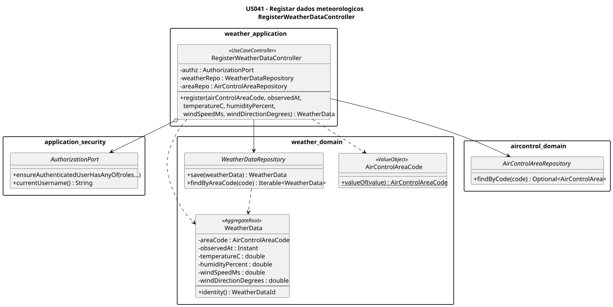

# US041 — Register weather data for an air control area

## 1. Context

Como **Weather Person**, registar uma observação meteorológica para uma **área de controlo aéreo** já existente no sistema. Os dados incluem instante de observação, temperatura, humidade e vento (velocidade e direção).

## 2. Requirements

**US041** As a Weather Person, I want to register weather data for an air control area.

**Acceptance criteria (resumo):**

- Área de controlo identificada por código (ex.: `PT-LIS`); código normalizado (trim, maiúsculas).
- Observação com `observedAt`, temperatura, humidade em [0, 100], vento ≥ 0, direção em [0, 360[ graus.
- Só é possível registar se a área existir (`AirControlAreaRepository.findByCode`).
- Papel exigido: `WEATHER_PERSON`.

**Dependencies:** US030 (authz), US050 (áreas de controlo registadas).

## 3. Analysis

- **Agregado `WeatherData`:** identidade `WeatherDataId`; `AirControlAreaCode` como value object embeddable; validações no construtor do agregado.
- **Aplicação:** `RegisterWeatherDataController` valida existência da área antes de `weatherRepo.save`.
- **Persistência:** entidade JPA `WeatherData` + `JpaWeatherDataRepository` (ou in-memory em testes).

## 4. Design

### 4.1 Class diagram



- [US041-class-diagram.puml](US041-class-diagram.puml)

Fluxo:

1. `RegisterWeatherDataUI` (user app) recolhe código da área, data/hora e medições.
2. `RegisterWeatherDataController.register` → `authz` (role `WEATHER_PERSON`).
3. `AirControlAreaCode.valueOf` + `areaRepo.findByCode` → rejeita área desconhecida.
4. `new WeatherData(...)` → `weatherRepo.save`.

Ver também agregado em [docs/global-artifacts/Aggregates/11_WeatherData.puml](../global-artifacts/Aggregates/11_WeatherData.puml).

### 4.2 Acceptance tests

| Teste | Critério |
|-------|----------|
| `WeatherDataTest` / `WeatherDataIdTest` / `AirControlAreaCodeTest` | VOs, limites de humidade/vento, código de área |
| `RegisterWeatherDataControllerTest` | Role, área conhecida/desconhecida, trim, valores limite, repositório devolve cópia |

## 5. Implementation

| Camada | Ficheiros |
|--------|-----------|
| Application | `RegisterWeatherDataController` |
| Domain | `WeatherData`, `WeatherDataId`, `AirControlAreaCode` |
| UI | `RegisterWeatherDataUI` (`aisafe.app.user.console`) |
| Persistence | `JpaWeatherDataRepository`, `JpaAirControlAreaRepository`, `persistence.xml` |

## 6. Integration / demonstration

1. Arrancar `AisafeUserApp` (bootstrap automático).
2. Login: opção **2** (*Login Weather Person*) → `weather` / `Weather123!`
3. Menu: opção **10** (*Register weather data*) → área `PT-LIS`, instante e medições válidas.
4. Confirmar; repetir com área inexistente → mensagem de erro.
5. (Opcional) Consultar tabela/entidade `WeatherData` na H2.

```bash
plantuml docs/us_41/US041-class-diagram.puml
mvn test -pl aisafe.infrastructure.application -Dtest=RegisterWeatherDataControllerTest
```

## 7. Observations

- `AirControlAreaCode` está em `eapli.aisafe.aircontrol.domain` (não em `weather.domain`); a validação de existência usa `AirControlAreaRepository` (US050).
- Temperatura aceita qualquer `double` no domínio (sem limites físicos explícitos além das regras de vento/humidade).
- Acesso remoto equivalente: **US044** (`rcomp.base/aisafe.app.weather.*`).
