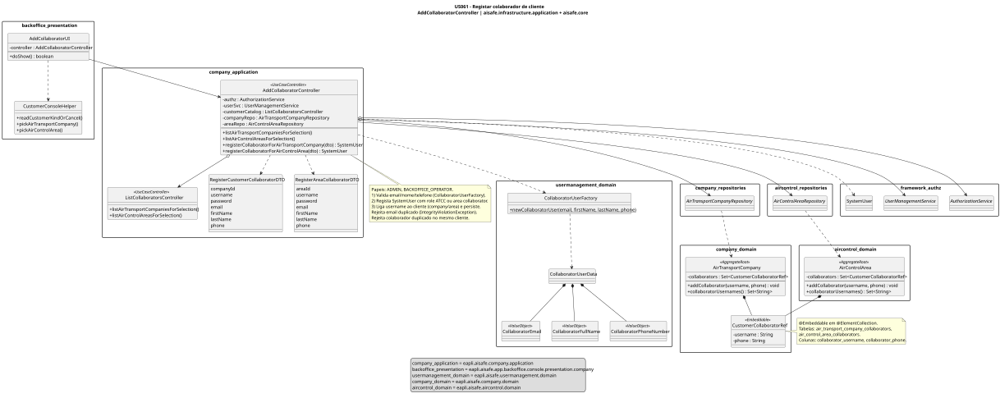

# US061 — Register a customer's collaborator

## 1. Context

Como **Backoffice Operator** (ou Admin), registar um colaborador associado a um **cliente** do sistema: companhia de transporte aéreo ou área de controlo. O colaborador é também um **utilizador** (`SystemUser`) com role adequada. Deve ser possível via UI do backoffice e via **bootstrap** (`CustomerCollaboratorsBootstrapper`).

## 2. Requirements

**US061** As a Backoffice Operator, I want to register a customer's collaborator.

**Acceptance criteria (resumo):**

- Cliente = companhia aérea **ou** área de controlo.
- Cada colaborador é um utilizador distinto do sistema (username, password, email, nome, telefone).
- Email único no sistema; não é obrigatório pertencer ao domínio da empresa.
- Ligação username ↔ cliente persistida no agregado (`AirTransportCompany` / `AirControlArea`).
- Bootstrap reproduz o fluxo (ex.: `tap_collab` na TAP).

**Dependencies:** US030 (authz), US031 (utilizadores), US060 (companhias), US050 (áreas de controlo).

## 3. Analysis

- **Domínio:** a ligação ao cliente vive no agregado do cliente (`Set<CustomerCollaboratorRef>` com username + phone), não no `SystemUser`.
- **Aplicação:** `AddCollaboratorController` valida dados com `CollaboratorUserFactory`, regista o user via `UserManagementService` e atualiza o agregado do cliente.
- **Persistência JPA:** `CustomerCollaboratorRef` em `@ElementCollection`; tabelas `air_transport_company_collaborators` e `air_control_area_collaborators`; utilizadores via `AisafeUserRepository` / `SystemUser`.

## 4. Design

### 4.1 Class diagram



- [US061-class-diagram.puml](US061-class-diagram.puml)

Fluxo principal:

1. `AddCollaboratorUI` → escolhe tipo de cliente e entidade (TAP, PT-LIS, …).
2. Recolhe credenciais e dados de contacto.
3. `AddCollaboratorController.registerCollaboratorForAirTransportCompany` ou `…ForAirControlArea`.
4. Cria `SystemUser` com role `AIR_TRANSPORT_COMPANY_COLLABORATOR` ou `AIR_CONTROL_AREA_COLLABORATOR`.
5. `company.addCollaborator(username, phone)` / `area.addCollaborator(…)` e `save`.

### 4.2 Acceptance tests

| Teste | Critério |
|-------|----------|
| `AddCollaboratorControllerTest` | Registo com sucesso, email duplicado, empresa/área inexistente, colaborador duplicado no mesmo cliente |
| `AirTransportCompanyCollaboratorTest` / `AirControlAreaCollaboratorTest` | Regras de `addCollaborator` no domínio |

## 5. Implementation

| Camada | Ficheiros |
|--------|-----------|
| Application | `AddCollaboratorController`, `RegisterCustomerCollaboratorDTO`, `RegisterAreaCollaboratorDTO`, `ListCollaboratorsController` (catálogo) |
| Domain | `CustomerCollaboratorRef`, `AirTransportCompany`, `AirControlArea`, `CollaboratorUserFactory`, VOs de contacto |
| UI | `AddCollaboratorUI`, `CustomerConsoleHelper` |
| Persistence | `JpaAirTransportCompanyRepository`, `JpaAirControlAreaRepository`, `AisafeUserRepository` |
| Bootstrap | `CustomerCollaboratorsBootstrapper` |

## 6. Integration / demonstration

1. Bootstrap ou arranque do backoffice (JPA: `application.properties` com `JpaRepositoryFactory`).
2. Login: `admin` / `Admin123!`.
3. Menu: **Customer collaborators → Register customer collaborator**.
4. Companhia TAP → username `new_collab01`, etc.
5. Verificar em **List customer collaborators** (US062) ou na BD: tabelas de colaboradores + `SYSTEM_USER`.

```bash
plantuml docs/us_61/US061-class-diagram.puml
```

## 7. Observations

- O telefone é validado e **persistido** na tabela de ligação ao cliente (`collaborator_phone`), não no `SystemUser` do framework.
- Roles ATCC só podem ser atribuídas no registo; a empresa do colaborador é resolvida depois via `findCompanyIdForCollaboratorUsername` (US070).
