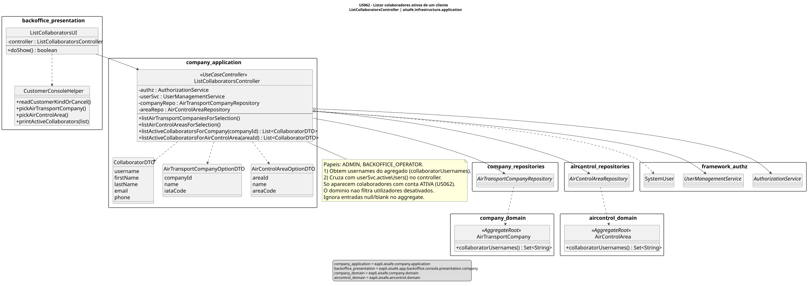

# US062 — List customer's collaborators

## 1. Context

Como **Backoffice Operator**, listar os colaboradores **ativos** de um dado cliente (companhia aérea ou área de controlo). Colaboradores **desativados** no sistema não devem aparecer.

## 2. Requirements

**US062** As a Backoffice Operator, I want to list all collaborators of a given customer. It should not list disabled collaborators.

**Acceptance criteria (resumo):**

- Listagem por companhia aérea ou por área de controlo.
- Apenas utilizadores com conta **ativa** (`userSvc.activeUsers()`).
- Usernames ligados no agregado do cliente mas sem user ativo não aparecem (ou aparecem filtrados).
- Apresentação: username, nome, email (e telefone no DTO quando disponível).

**Dependencies:** US061 (colaboradores registados), US030/031 (utilizadores e estados).

## 3. Analysis

- O agregado guarda **usernames** (`CustomerCollaboratorRef` / `collaboratorUsernames()`).
- O **controller** cruza essa lista com `userSvc.activeUsers()` — o domínio não filtra inativos.
- Não lista passwords nem utilizadores desativados no sistema.
- Reutiliza `ListCollaboratorsController` também na US061 para seleção de clientes (`*OptionDTO`).

## 4. Design

### 4.1 Class diagram



- [US062-class-diagram.puml](US062-class-diagram.puml)

Fluxo:

1. `ListCollaboratorsUI` → tipo de cliente + seleção (helper partilhado com US061).
2. `listActiveCollaboratorsForCompany(companyId)` ou `…ForAirControlArea(areaId)`.
3. Carrega agregado → obtém set de usernames → filtra `activeUsers()` → monta `CollaboratorDTO`.

### 4.2 Acceptance tests

| Teste | Critério |
|-------|----------|
| `ListCollaboratorsControllerTest` | Só ativos; ignora desativados; empresa/área inexistente; usernames null/blank no aggregate |

## 5. Implementation

| Camada | Ficheiros |
|--------|-----------|
| Application | `ListCollaboratorsController`, `CollaboratorDTO`, `AirTransportCompanyOptionDTO`, `AirControlAreaOptionDTO` |
| UI | `ListCollaboratorsUI`, `CustomerConsoleHelper.printActiveCollaborators` |
| Domain | `AirTransportCompany.listActiveCollaborators()`, `AirControlArea.listActiveCollaborators()` |

## 6. Integration / demonstration

1. Backoffice com dados de bootstrap (TAP + `tap_collab`).
2. **Customer collaborators → List customer collaborators (active only)**.
3. Escolher TAP → deve listar colaboradores ativos (ex. `tap_collab`).
4. Desativar um user (US032, se implementada) e repetir — não deve aparecer.

```bash
plantuml docs/us_62/US062-class-diagram.puml
```

## 7. Observations

- `CollaboratorDTO.phone` pode ser `null` na listagem porque o telefone está no agregado do cliente; melhoria futura: preencher a partir de `CustomerCollaboratorRef.phone()`.
- A US062 não expõe API de desativação; apenas **filtra** na leitura.
