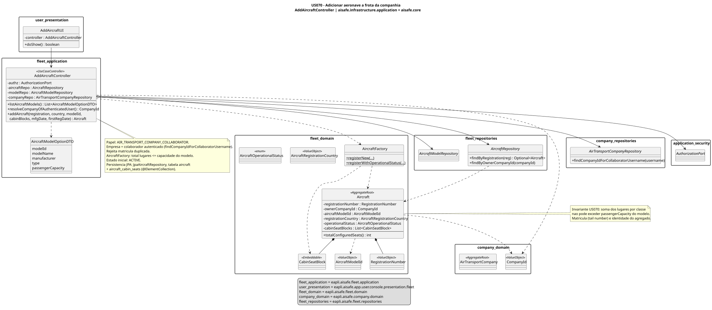

# US070 — Add an aircraft to an air transport company

## 1. Context

Como **Air Transport Company Collaborator (ATCC)**, adicionar uma aeronave à frota da **própria companhia**. A aeronave referencia um modelo (com motores certificados no modelo), configuração de lugares por classe, matrícula única, país de registo e estado operacional.

## 2. Requirements

**US070** As an Air Transport Company Collaborator, I want to add an aircraft to my company's fleet.

**Acceptance criteria (resumo):**

- Modelo escolhido entre os registados; lugares por classe; total ≤ capacidade do modelo.
- Matrícula (tail number) **única**.
- País de registo (ISO 3166-1 alpha-2).
- Estado operacional (inicial: `ACTIVE`).
- Datas: fabrico e/ou primeira matrícula (pelo menos uma).
- Empresa = companhia do colaborador autenticado.

**Dependencies:** US055 (modelos), US060 (companhias), US061 (colaborador ATCC ligado à companhia), US030 (authz).

## 3. Analysis

- **Agregado `Aircraft`:** identidade `RegistrationNumber`; referências por ID a `CompanyId` e `AircraftModelId` (sem referência directa ao objeto modelo).
- **`AircraftFactory`:** invariante de capacidade (`totalConfiguredSeats() <= model.passengerCapacity()`).
- **Persistência JPA:** entidade `Aircraft`, `@ElementCollection` `aircraft_cabin_seats`, `JpaAircraftRepository`.

## 4. Design

### 4.1 Class diagram



- [US070-class-diagram.puml](US070-class-diagram.puml)

Fluxo:

1. `AddAircraftUI` (user app) → lista modelos → matrícula, país, datas, cabines.
2. `AddAircraftController.addAircraft` → resolve `CompanyId` do user ATCC.
3. `AircraftFactory.registerNew` → `aircraftRepo.save`.
4. Listagens US072a+ usam `AircraftRepository` com filtros por companhia/modelo/etc.

Ver também agregado em [docs/global-artifacts/Aggregates/08_Aircraft.puml](../global-artifacts/Aggregates/08_Aircraft.puml).

### 4.2 Acceptance tests

| Teste | Critério |
|-------|----------|
| `AircraftFactoryTest` / `AircraftTest` | Capacidade, matrícula, país, datas, estado |
| `AddAircraftControllerTest` | Autorização ATCC, matrícula duplicada, modelo inexistente, empresa do user |

## 5. Implementation

| Camada | Ficheiros |
|--------|-----------|
| Application | `AddAircraftController`, `AircraftModelOptionDTO` |
| Domain | `Aircraft`, `AircraftFactory`, `CabinSeatBlock`, `RegistrationNumber`, `AircraftOperationalStatus`, … |
| UI | `AddAircraftUI` (`aisafe.app.user.console`) |
| Persistence | `JpaAircraftRepository`, `persistence.xml` (classe `Aircraft`) |
| Bootstrap | `FleetAircraftBootstrapper` (demo `CS-TST`) |

## 6. Integration / demonstration

1. Bootstrap + **user app** com JPA (incluir JAR do backoffice no classpath ou `application.properties` com `JpaRepositoryFactory`).
2. Login ATCC: `tap_collab` / `TapCollab1!`.
3. Menu: **Add aircraft to fleet**.
4. Escolher modelo, matrícula `CS-TEST99`, país `PT`, cabines dentro da capacidade.
5. Confirmar; listar frota (US072a) ou consultar `aircraft` / `aircraft_cabin_seats` na H2.

```bash
plantuml docs/us_70/US070-class-diagram.puml
```

## 7. Observations

- Motores ficam no **modelo** (`AircraftModel` + motores certificados); a aeronave guarda só `AircraftModelId`.
- User app sem `application.properties` próprio usa repositório **in-memory** por defeito — para testar JPA, usar configuração do módulo backoffice no classpath.
- Desativação de aeronaves: US071 (`markRetired`).
