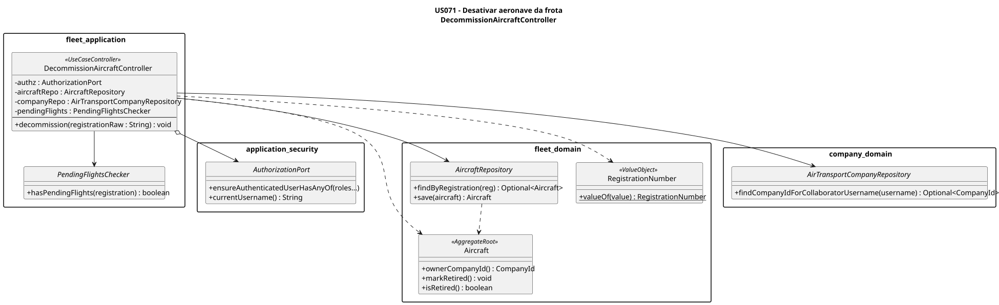

# US071 — Decommission an aircraft from the company fleet

## 1. Context

Como **Air Transport Company Collaborator (ATCC)**, retirar da frota operacional uma aeronave da **própria companhia**, marcando-a como `RETIRED`. Não é permitido se existirem voos pendentes associados à matrícula.

## 2. Requirements

**US071** As an Air Transport Company Collaborator, I want to decommission an aircraft from my company's fleet.

**Acceptance criteria (resumo):**

- Matrícula válida e normalizada; aeronave deve existir e pertencer à companhia do colaborador autenticado.
- Não desativar se `PendingFlightsChecker` reportar voos pendentes para essa matrícula.
- Aeronave já retirada → erro de estado (`markRetired`).
- Papel: `AIR_TRANSPORT_COMPANY_COLLABORATOR`.

**Dependencies:** US070 (aeronaves na frota), US060/061 (colaborador ligado à companhia), US030 (authz).

## 3. Analysis

- **Agregado `Aircraft`:** `markRetired()` altera `operationalStatus` para `RETIRED`; invariantes de listagem US072 excluem retiradas.
- **`PendingFlightsChecker`:** porto de aplicação (implementação in-memory até existir módulo de voos).
- **Resolução de companhia:** `FleetListing.requireCompanyOfUser` via `AirTransportCompanyRepository.findCompanyIdForCollaboratorUsername`.

## 4. Design

### 4.1 Class diagram



- [US071-class-diagram.puml](US071-class-diagram.puml)

Fluxo:

1. `DecommissionAircraftUI` pede matrícula.
2. `DecommissionAircraftController.decommission` → role ATCC → `companyId` do user.
3. `RegistrationNumber.valueOf` → `aircraftRepo.findByRegistration`.
4. Verifica `ownerCompanyId` e `pendingFlights.hasPendingFlights`.
5. `aircraft.markRetired()` → `aircraftRepo.save`.

### 4.2 Acceptance tests

| Teste | Critério |
|-------|----------|
| `AircraftTest` / `AircraftOperationalStatusTest` | `markRetired`, estados |
| `DecommissionAircraftControllerTest` | Sucesso, outra companhia, voo pendente, já retirada, matrícula inválida, user sem empresa |

## 5. Implementation

| Camada | Ficheiros |
|--------|-----------|
| Application | `DecommissionAircraftController`, `PendingFlightsChecker`, `FleetListing` |
| Domain | `Aircraft`, `RegistrationNumber`, `AircraftOperationalStatus` |
| UI | `DecommissionAircraftUI` (`aisafe.app.user.console`) |
| Persistence | `JpaAircraftRepository`, `JpaAirTransportCompanyRepository` |
| Bootstrap | `FleetAircraftBootstrapper` (aeronave demo `CS-TST`) |

## 6. Integration / demonstration

1. Bootstrap TAP + colaborador ATCC + aeronave `CS-TST`.
2. Login: opção **3** (*Air Transport Company Collaborator*) → `tap_collab` / `TapCollab1!`
3. Menu: opção **21** (*Decommission aircraft*) → matrícula `CS-TST`.
4. Confirmar; listar frota (US072, opções 22–25) — aeronave não aparece nas listagens ativas.
5. Tentar desativar de novo → erro.

```bash
plantuml docs/us_71/US071-class-diagram.puml
mvn test -pl aisafe.infrastructure.application -Dtest=DecommissionAircraftControllerTest
```

## 7. Observations

- Complementa US070 (`AddAircraftController`); a frota “ativa” nas US072 ignora `RETIRED`.
- `PendingFlightsChecker` em memória: testes usam `markPending` no double; produção JPA mantém implementação in-memory até integração com planos de voo.
