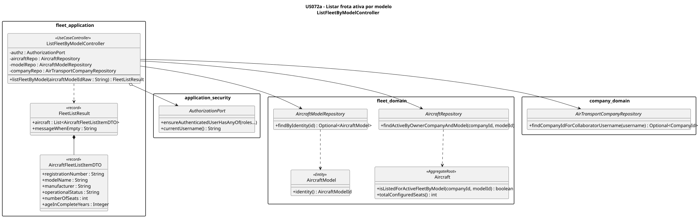

# US072 — List the company's active fleet (filters)

## 1. Context

Como **Air Transport Company Collaborator**, listar a frota **ativa** da companhia do utilizador autenticado, com filtros por modelo, fabricante, capacidade de passageiros ou idade em anos completos. Resultados ordenados por matrícula; mensagem quando vazio.

## 2. Requirements

Variantes do enunciado:

| ID | Filtro |
|----|--------|
| **US072a** | Modelo de aeronave (`AircraftModelId`) |
| **US072b** | Fabricante do modelo (`ManufacturerNormalizer`) |
| **US072c** | Capacidade total de lugares configurados |
| **US072d** | Idade em anos completos (data de fabrico preferida à 1.ª matrícula) |

Critérios comuns:

- Apenas aeronaves da companhia do colaborador; excluir `RETIRED`; incluir `ACTIVE` e `MAINTENANCE`.
- Papel: `AIR_TRANSPORT_COMPANY_COLLABORATOR`.

**Dependencies:** US070, US055 (modelos), US060/061, US030.

## 3. Analysis

- Quatro controladores independentes partilham `FleetListing`, `FleetListResult` e `AircraftFleetListItemDTO`.
- Repositório `AircraftRepository` expõe queries por modelo, capacidade e idade; listagem por fabricante filtra em memória via `FleetListing.activeByManufacturer`.
- **US072d:** `Supplier<LocalDate>` injectável (`LocalDate::now` no construtor default) para testes determinísticos.

## 4. Design

### 4.1 Class diagrams

| Variante | Diagrama |
|----------|----------|
| US072a | [US072a-class-diagram.puml](US072a-class-diagram.puml) ·  |
| US072b | [US072b-class-diagram.puml](US072b-class-diagram.puml) |
| US072c | [US072c-class-diagram.puml](US072c-class-diagram.puml) |
| US072d | [US072d-class-diagram.puml](US072d-class-diagram.puml) |

Fluxo típico (ex.: US072a):

1. UI pede identificador do modelo (UUID).
2. `ListFleetByModelController.listFleetByModel` → ATCC → `companyId`.
3. `aircraftRepo.findActiveByOwnerCompanyAndModel` → enriquecer com `AircraftModel` → DTOs ordenados.
4. `FleetListResult.of(rows, NO_RESULTS_BY_MODEL)` se vazio.

Helpers partilhados: `FleetListing.requireCompanyOfUser`, `requireModel`, `toRow` / `toRowWithAge`.

### 4.2 Acceptance tests

| Teste | Variante |
|-------|----------|
| `ListFleetByModelControllerTest` | US072a (7+ testes) |
| `ListFleetByMakerControllerTest` | US072b |
| `ListFleetByPassengerCapacityControllerTest` | US072c (11 testes) |
| `ListFleetByAgeControllerTest` | US072d (12 testes) |
| `FleetListingTest` | Helpers partilhados |
| `AircraftFleetListItemDTOTest` / `FleetListResultTest` | DTOs e mensagens vazias |

## 5. Implementation

| Camada | Ficheiros |
|--------|-----------|
| Application | `ListFleetByModelController`, `ListFleetByMakerController`, `ListFleetByPassengerCapacityController`, `ListFleetByAgeController`, `FleetListing`, `FleetListResult`, `AircraftFleetListItemDTO`, `ManufacturerNormalizer` |
| Domain | `Aircraft` (métodos `isListedForActiveFleetBy*`), `AircraftModel` |
| UI | `ListFleetByModelUI`, `ListFleetByMakerUI`, `ListFleetByPassengerCapacityUI`, `ListFleetByAgeUI` |
| Persistence | `JpaAircraftRepository`, `JpaAircraftModelRepository` |

## 6. Integration / demonstration

1. Bootstrap companhia + ATCC + modelos + várias aeronaves (capacidades/idades distintas).
2. Login: opção **3** → `tap_collab` / `TapCollab1!`
3. Testar cada menu de listagem:
   - **22** — por capacidade de passageiros
   - **23** — por idade
   - **24** — por modelo
   - **25** — por fabricante
4. Usar filtros com e sem resultados (mensagem `FleetListResult.messageWhenEmpty`).
5. Desativar uma aeronave (US071, opção **21**) e confirmar que deixa de aparecer.

```bash
plantuml docs/us_72/US072a-class-diagram.puml
plantuml docs/us_72/*.puml
mvn test -pl aisafe.infrastructure.application -Dtest=ListFleetByModelControllerTest,ListFleetByMakerControllerTest,ListFleetByPassengerCapacityControllerTest,ListFleetByAgeControllerTest
```

## 7. Observations

- Nos `.puml`, os controladores injectam **repositórios** directamente (padrão do projeto, como US050/US070).
- US072c/072d: validação de entrada com `Preconditions` / `IllegalArgumentException` para capacidade e idade não positivos ou não inteiros.
- Diagramas separados por variante reduzem ruído e alinham com quatro casos de uso no enunciado.
